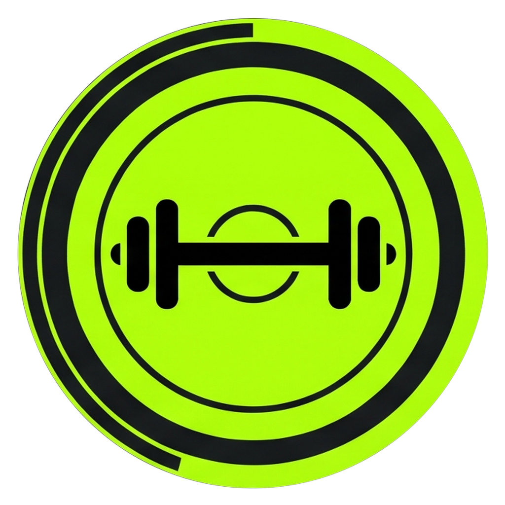

<div align="center">



# IronLog

### Precision Strength Tracking • Macro Nutrition • Biometric Analytics

[](https://expo.dev)
[](https://expo.dev)
[](https://www.typescriptlang.org/)
[](#license)

<p align="center">
  IronLog is a high-performance strength training, nutrition, and biometric tracking platform built for dedicated lifters, athletes, and coaches. Engineered with an offline-first foundation and an Obsidian Kinetic design aesthetic, it provides friction-free workout execution, instant set logging, intelligent volume analytics, and periodization planning.
</p>

</div>

---

## Highlights

<table>
  <tr>
    <td width="50%">
      <h3>⚡ Friction-Free Workout Logging</h3>
      <ul>
        <li><b>High-Affordance Live Runner:</b> Real-time set tracker with integrated rest countdown timers and warm-up, working, dropset, and failure tags.</li>
        <li><b>Personal Record Engine:</b> Instant PR recognition and estimated 1RM calculations as lifts are completed.</li>
        <li><b>Historical Calendar Selector:</b> Complete past workout logging with an interactive date navigator.</li>
      </ul>
    </td>
    <td width="50%">
      <h3>🥗 Targeted Nutrition Tracking</h3>
      <ul>
        <li><b>Dynamic Macronutrient Targets:</b> Real-time tracking against daily caloric, protein, carbohydrate, and fat allocations.</li>
        <li><b>Meal Breakdown:</b> Categorized logging across breakfast, lunch, dinner, and snacks with remaining budget projections.</li>
        <li><b>Extensive Food Library:</b> Quick search backed by comprehensive nutritional composition databases.</li>
      </ul>
    </td>
  </tr>
  <tr>
    <td width="50%">
      <h3>📈 Anthropometrics & Strength Progression</h3>
      <ul>
        <li><b>Weight Momentum:</b> Daily body mass tracking with 7-day smoothed moving averages and target trajectory indicators.</li>
        <li><b>Circumference Analytics:</b> Complete tape measurement logging (chest, waist, arms, thighs, and neck).</li>
        <li><b>Strength Standards:</b> Benchmarking against standardized lift classifications.</li>
      </ul>
    </td>
    <td width="50%">
      <h3>🏆 Visual Insights & Progression Tiers</h3>
      <ul>
        <li><b>Musculoskeletal Heatmap:</b> Anatomical volume distribution mapping trained muscle groups across workout cycles.</li>
        <li><b>Radar Balance Scores:</b> Push/pull and upper/lower symmetry analytics to prevent muscular imbalances.</li>
        <li><b>Rank & Achievement Milestones:</b> Gamified XP progression system recognizing consistency, streak milestones, and lifetime volume.</li>
      </ul>
    </td>
  </tr>
</table>

---

## Experience & Design

* **Obsidian Kinetic Aesthetic:** Crafted from the ground up with a dark-mode palette, Volt Lime accents, and high-contrast typography optimized for dimly lit gym floors.
* **Offline-Resilient Architecture:** Full local data persistence ensures every set, rep, and meal entry is saved instantly without waiting on network availability.
* **Tactile Haptic Feedback:** Zero-latency physical touch confirmation with custom micro-interactions on every set completion and milestone.

---

## Getting Started

### Prerequisites

* [Node.js](https://nodejs.org/) (v18 or higher)
* [npm](https://www.npmjs.com/) or [yarn](https://yarnpkg.com/)
* [Expo Go](https://expo.dev/go) on your mobile device (iOS or Android) or a local emulator

### Quick Start

1. **Clone the repository:**
   ```bash
   git clone https://github.com/ShivenThakker/Iron-Log.git
   cd Iron-Log
   ```

2. **Install dependencies:**
   ```bash
   npm install
   ```

3. **Configure environment:**
   Create an environment configuration file for the mobile application:
   ```bash
   cp apps/mobile/.env.example apps/mobile/.env
   ```

4. **Launch the development server:**
   ```bash
   npm run start --workspace=mobile
   ```

5. **Open on your device:**
   Scan the displayed QR code with your camera (iOS) or the Expo Go app (Android), or press `a` for Android Emulator / `i` for iOS Simulator.

---

## Quality Assurance

Validate code health and run test suites:

```bash
# Typecheck mobile and backend codebases
npm run typecheck

# Execute backend unit and integration test suites
npm test --workspace=api
```

---

## License

This project is licensed under the MIT License.
